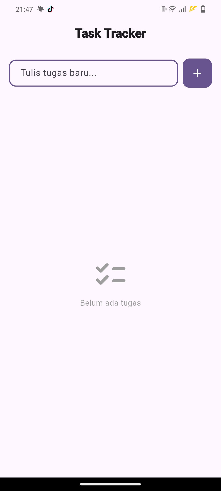
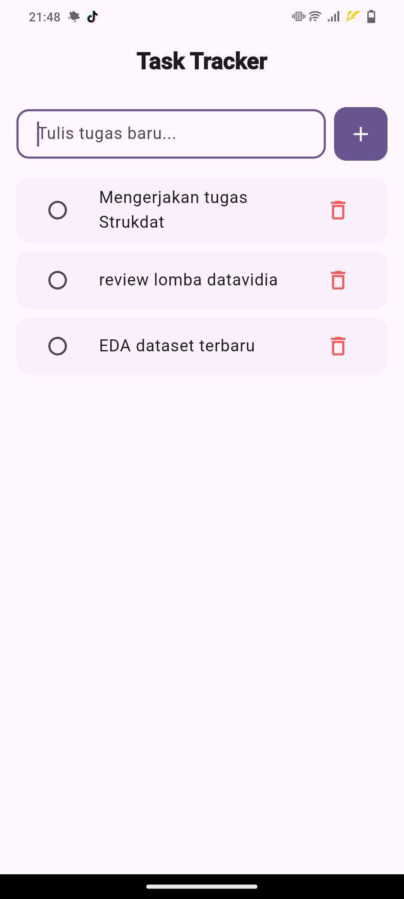
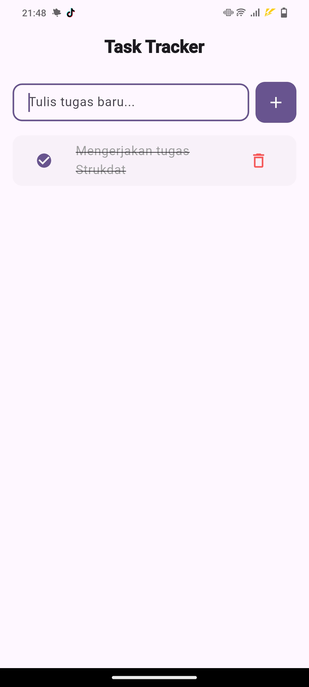

# Task Tracker

Aplikasi mobile sederhana untuk mencatat daftar tugas harian, dibuat dengan Flutter sebagai studi kasus Open Recruitment Divisi Mobile Programming.

## Identitas

|          |                 |
| -------- | --------------- |
| **Nama** | Muhammad Naufal |
| **NIM**  | 103012530062    |

## Screenshot

| Tampilan awal                                   | Tambah tugas                                         | Tandai selesai                                          | Setelah hapus                                              |
| ----------------------------------------------- | ---------------------------------------------------- | ------------------------------------------------------- | ---------------------------------------------------------- |
|  |  |  |  |

## Cara Menjalankan

### Prasyarat

- Flutter SDK (cek dengan `flutter doctor`)
- Android SDK
- HP Android dengan USB debugging aktif, atau emulator

### Langkah

```bash
git clone https://github.com/MBopal/task-tracker-motion.git
cd task-tracker-motion
flutter pub get
flutter run
```

### Build APK

```bash
flutter build apk --release
```

File APK akan berada di `build/app/outputs/flutter-apk/app-release.apk`.

### Deklarasi Penggunaan AI

- Apakah menggunakan AI? Ya

- Tool AI yang digunakan: Claude, Gemini Hydrogen

- Estimasi persentase kontribusi AI: 40 % (Maksimal 40%)

- Bagian kode/fitur yang dibantu AI:
  - debugging error hot reload
  - setup Android SDK dan JAVA_HOME
  - referensi syntax Checkbox dan Padding
  - Membuat tampilan text field jadi lebih modern
  - Fitur untuk menghapus task
  - penjelasan konsep StatefulWidget dan setState

- Pernyataan:

  Saya menyatakan bahwa saya memahami alur dan fungsi dari seluruh kode yang ada dalam repositori ini
